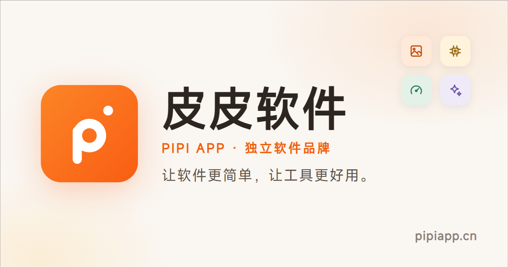

<div align="center">



**让软件更简单，让工具更好用。**

[](https://pipiapp.cn)
[](https://vuejs.org)
[](https://www.typescriptlang.org)
[](https://vite.dev)
[](https://pages.cloudflare.com)

[🌐 访问官网](https://pipiapp.cn) · [🧰 在线工具](https://pipiapp.cn/tools) · [💧 皮皮去水印（免安装，打开即用）](https://qushuiyin.pipiapp.cn/)

</div>

---

「皮皮软件（PiPi App）」是面向普通用户的独立软件品牌，提供图片处理、文件管理、系统工具、效率工具与 AI 应用等实用软件。这个仓库是它的**品牌官网**：纯静态、开箱即部署，也是一套「数据驱动 + SSG 预渲染」的中小型官网工程模板。

## ✨ 这个仓库的看点

- **纯数据驱动**——新增一款软件 = 在 `src/data/products.ts` 写一条 TypeScript 记录。首页推荐、软件列表（自动支持搜索 / 分类筛选 / 状态标识）、详情页静态页、`sitemap.xml` 全部自动生成，零改动页面代码。
- **真正的 SSG**——基于 [vite-ssg](https://github.com/antfu/vite-ssg)，构建时把每条路由渲染成完整 HTML，不靠客户端 JS 拼内容，对百度 / Google / 必应的爬虫天然友好（国内站点的刚需）。
- **运行时依赖只有 3 个**——Vue、Vue Router、@unhead/vue。界面是手写 CSS 设计系统（[design tokens](src/styles/tokens.css) 统一品牌色 / 圆角 / 阴影 / 间距），没有 UI 框架，构建产物小而快。
- **SEO 工程化**——每页独立的 title / description / canonical / Open Graph，软件详情页输出 `SoftwareApplication` 结构化数据，构建时自动生成 `sitemap.xml`，并附带构建后内链检查脚本。
- **纯静态产物**——`dist/` 就是一堆 HTML / CSS / JS，扔到 Cloudflare Pages、GitHub Pages、Nginx 都能跑，无需服务器。

## 💧 已上线：皮皮去水印

> [https://qushuiyin.pipiapp.cn/](https://qushuiyin.pipiapp.cn/)

粘贴短视频分享链接，一键解析**无水印视频、图集原图与 Live 实况照片**。免安装、打开即用，支持抖音 / 快手 / 小红书 / B 站 / 微博 / 视频号等主流平台。

更多软件与在线工具持续更新中，欢迎 [Star](https://github.com/wlor0623/pipiapp.cn/stargazers) 关注上新。

## 🚀 快速开始

```bash
git clone <本仓库>
cd pipiapp.cn
npm install
npm run dev        # http://localhost:5173
```

| 命令 | 说明 |
| --- | --- |
| `npm run dev` | 本地开发 |
| `npm run build` | 生成 sitemap + SSG 静态构建，输出 `dist/` |
| `npm run preview` | 本地预览构建产物 |
| `npm run typecheck` | TypeScript 类型检查 |
| `node scripts/check-links.mjs` | 构建后内链检查 |
| `npm run deploy` | 构建并部署到 Cloudflare Pages |

要求：Node.js 20+（vite-ssg 需要）。

## 📦 数据驱动工作流

### 新增一款软件

编辑 [`src/data/products.ts`](src/data/products.ts)，向 `products` 数组添加一条记录：

```ts
{
  id: 'pipi-resize',
  name: '皮皮批量缩图',
  slug: 'pipi-resize',              // 详情页路由 /software/pipi-resize
  tagline: '拖进去，批量缩小，一步到位。',
  description: '两三句话介绍这款软件解决什么问题、适合谁用。',
  icon: 'image',                    // 内置图标，见 src/components/icons.ts
  category: 'image',                // image / system / efficiency / files / ai
  platforms: ['windows', 'macos'],
  status: 'released',               // released / developing / planned
  version: '1.0.0',
  updatedAt: '2026-10-01',
  downloadUrl: 'https://…',         // 可选：没有真实地址就别填，页面自动隐藏下载按钮
  features: ['功能点一', '功能点二'], // 可选：详情页特性
  faq: [{ question: '…', answer: '…' }], // 可选
}
```

保存后重新 `npm run build`——首页、列表页、详情页、sitemap 全部自动同步。完整字段模板见文件底部注释。

### 新增一款在线工具

编辑 [`src/data/tools.ts`](src/data/tools.ts)，向 `tools` 数组添加一条记录（工具托管在子域名或外部地址，无需站内详情页）：

```ts
{
  id: 'pipi-example-tool',
  name: '皮皮示例工具',
  tagline: '一句话简介，卡片与首页横条使用。',
  description: '两三句话介绍这个工具做什么、怎么用。',
  icon: 'video',
  tags: ['抖音', 'B 站'],
  url: 'https://xxx.pipiapp.cn/',
  featured: true,                   // 首页在线工具区展示
}
```

### 站点信息

品牌名、域名、口号、联系方式（`contactEmail`）等集中在 [`src/data/site.ts`](src/data/site.ts)，留空时页面自动隐藏对应入口，不会出现占位假数据。

## 📁 目录结构

```
├─ scripts/
│  ├─ generate-sitemap.mjs     # 构建时自动生成 sitemap.xml
│  ├─ check-links.mjs          # 构建后全站内链检查
│  └─ brand-assets.html        # Logo / OG 图 / favicon 的生成源文件
├─ src/
│  ├─ data/                    # ★ 全站唯一数据源（软件 / 工具 / 站点信息）
│  ├─ pages/                   # 路由页面（首页 / 软件 / 工具 / 关于 / 法律页 / 404）
│  ├─ components/              # 卡片、列表、图标、品牌标识等组件
│  ├─ composables/useSeo.ts    # 每页 title / meta / canonical / OG
│  └─ styles/tokens.css        # 设计令牌：品牌色 / 圆角 / 阴影 / 间距
└─ public/                     # favicon / OG 图 / robots.txt / sitemap.xml
```

## 🔍 SEO 实现清单

- 每页独立 title / description / canonical / Open Graph（`src/composables/useSeo.ts`）
- 软件详情页输出 `SoftwareApplication` 结构化数据（仅真实字段，不虚构版本号）
- `public/robots.txt` + 构建时自动生成的 `sitemap.xml`（新增软件页自动收录）
- vite-ssg 全路由预渲染，首屏即完整 HTML
- `scripts/check-links.mjs` 构建后检查死链，防止 SEO 硬伤

## ☁️ 部署

产物为纯静态文件，部署方式任选：

- **Cloudflare Pages（本项目在用）**：项目名 `pipiapp`，生产分支 `main`，`npm run deploy` 一键部署（需先 `wrangler login`；国内网络环境建议先设置 `HTTPS_PROXY`）。自定义域名 `pipiapp.cn` 通过 apex CNAME 指向 `pipiapp.pages.dev`。
- **GitHub Pages**：产物即用，`404.html` 已自动生成，无需额外配置。
- **Nginx / 其他静态托管**：建议配置 SPA 回退（所有路径回退 `index.html`），或将 `404.html` 配置为错误页兜底。

## 🗺️ 页面路由

| 路由 | 说明 |
| --- | --- |
| `/` | 首页（Hero、产品区、在线工具、品牌理念、关于） |
| `/software` | 全部软件（分类筛选 + 关键词搜索 + 状态标识） |
| `/software/:slug` | 软件详情（介绍 / 功能 / 截图 / 更新日志 / FAQ / 下载） |
| `/tools` | 在线工具（免安装、打开即用） |
| `/about` | 关于（含 `#contact` 联系方式锚点） |
| `/privacy` `/terms` | 隐私政策 / 服务条款 |
| 其余路径 | 404（构建为 `dist/404.html` 供托管平台兜底） |

---

<div align="center">

**[pipiapp.cn](https://pipiapp.cn)** · 让软件更简单，让工具更好用。

觉得这套「数据驱动官网」思路有用，欢迎 Star ⭐

</div>

[](https://github.com/wlor0623/pipiapp.cn/stargazers)
